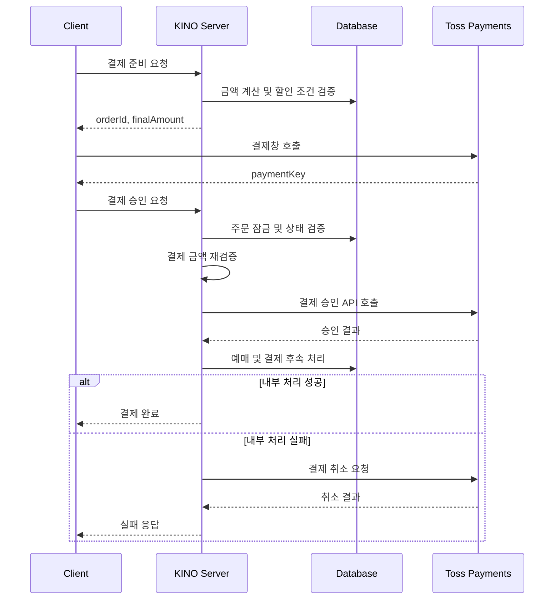

# 결제 승인과 데이터 일관성

> 외부 PG의 결제 승인과 내부 DB 트랜잭션 사이에서
> 발생할 수 있는 불일치 문제를 어떻게 처리할 것인가?

## 1. 문제 상황

KINO는 토스페이먼츠를 이용해 영화 예매 결제를 처리합니다.

결제 과정은 크게 두 시스템에 걸쳐 진행됩니다.

- 외부 시스템: 토스페이먼츠 결제 승인
- 내부 시스템: 예매 확정, 쿠폰 사용 확정, 포인트 처리

문제는 두 시스템의 작업을 하나의
데이터베이스 트랜잭션으로 묶을 수 없다는 점입니다.

예를 들어 PG에서 결제 승인이 완료된 후
내부 DB 작업에서 예외가 발생하면 다음과 같은
불일치 상태가 생길 수 있습니다.

| 구분 | 상태 |
|:--|:--|
| 토스페이먼츠 결제 | 승인 완료 |
| 내부 예매 | 확정 실패 |
| 사용자 | 결제했지만 예매가 완료되지 않음 |

이 문제를 해결하기 위해 결제 승인 이후의
실패 처리와 중복 요청 방지 구조를 함께 설계했습니다.

---

## 2. 원인 분석

### 2.1 외부 API는 DB 롤백의 영향을 받지 않는다

Spring의 `@Transactional`은 관리 대상 DB 작업의
원자성을 보장하지만, 외부 PG에 이미 전달한
승인 요청까지 롤백하지는 못합니다.

따라서 PG 승인 이후 DB 트랜잭션이 실패하더라도
외부 결제는 승인 상태로 남을 수 있습니다.

### 2.2 동일한 결제 승인 요청이 중복될 수 있다

다음과 같은 상황에서는 결제 승인 API에
동일한 요청이 여러 번 전달될 수 있습니다.

- 프런트엔드의 중복 실행
- 사용자의 결제 완료 페이지 재진입
- 네트워크 타임아웃 이후 재시도

이때 기존 결제 상태를 확인하지 않으면
이미 처리한 주문에 대해 중복 승인을 시도할 위험이 있습니다.

---

## 3. 기술적 의사결정

### 3.1 중복 요청을 어떻게 방지할 것인가?

| 방법 | 장점 | 고려할 문제 |
|:--|:--|:--|
| 프런트엔드 중복 방지 | 불필요한 요청 감소 | 서버로 직접 전송되는 요청은 방어하지 못함 |
| 결제 상태 검사 | 이미 완료된 요청 구분 | 동시 요청이 검사 단계를 함께 통과할 수 있음 |
| 비관적 락 + 상태 검사 | 동일 주문에 대한 동시 처리 제어 | 락 대기와 트랜잭션 점유 비용 발생 |

KINO에서는 주문을 조회하는 구간에
비관적 락을 적용하고, 결제 상태를 함께 검사했습니다.

이를 통해 동일 주문에 대한 동시 요청을 직렬화하고,
이미 완료된 결제에 대한 중복 처리를 방지하도록 구성했습니다.

### 3.2 PG 승인 이후 DB 처리가 실패하면?

외부 PG 승인 결과는 DB 롤백만으로 되돌릴 수 없습니다.

따라서 내부 후속 처리에 실패하는 경우
토스페이먼츠의 결제 취소 API를 호출하는
보상 처리 방식을 적용했습니다.

이 방식은 서로 다른 시스템을 하나의 트랜잭션으로
묶는 대신, 실패했을 때 별도의 반대 작업으로
상태 불일치를 줄이는 접근입니다.

---

## 4. 적용한 구조

### 4.1 결제 처리 흐름

### 4.2 서버 측 결제 금액 검증

클라이언트가 전달한 결제 금액을 그대로 신뢰하지 않고,
서버에서 계산한 금액과 비교하도록 구성했습니다.

검증 대상에는 티켓 가격, 쿠폰 할인,
포인트 사용 조건 등이 포함됩니다.

검증에 실패한 요청은 PG 승인 전에 차단합니다.

### 4.3 결제 승인 멱등성

동일 주문에 대한 결제 승인 요청이 반복되더라도
이미 완료된 작업을 중복 실행하지 않도록
주문 상태와 비관적 락을 이용해 처리했습니다.

핵심 구현:
- 주문 단위 비관적 락
- 결제 완료 상태 확인
- 중복 승인 요청 제어

### 4.4 승인 이후 실패에 대한 보상 처리

PG 승인이 성공한 이후 내부 후속 처리 과정에서
예외가 발생하면 결제 취소 API를 호출하도록 구현했습니다.

단, 보상 취소는 별도의 외부 API 호출이므로
취소 자체의 실패 가능성도 존재합니다.

---

## 5. 검증이 필요한 시나리오

| 시나리오 | 확인할 사항 |
|:--|:--|
| 동일 주문의 승인 API 중복 호출 | 중복 PG 승인 방지 |
| 서로 다른 요청의 동시 승인 | 주문 잠금 및 상태 검사 |
| 클라이언트 결제 금액 변조 | 서버 금액 불일치 차단 |
| PG 승인 후 DB 예외 발생 | 보상 취소 호출 및 처리 결과 |
| PG 보상 취소 API 실패 | 상태 불일치 및 후속 복구 방안 |

위 항목의 실제 테스트 실행 여부와 결과는
구현 코드 및 테스트 기록을 확인해 보완할 예정입니다.

---

## 6. 남은 한계와 개선 방향

### 보상 취소 실패 가능성

내부 DB 작업에 실패한 뒤 PG 취소 API까지 실패하면
결제 승인 상태가 남을 가능성이 있습니다.

이 경우 취소 요청의 재시도나
관리자 확인을 위한 별도 복구 체계가 필요합니다.

### 락 점유 시간

비관적 락으로 동시 요청을 제어하는 방식은
안전성을 높이지만, 락을 유지하는 동안
외부 API 응답을 기다리면 대기 시간이 길어질 수 있습니다.

따라서 향후에는 락 유지 구간을 줄이는 방식도
검토할 수 있습니다.

---

## 7. 구현 근거

- PaymentService.java — 결제 승인, 금액 검증, 보상 취소
- PaymentRepository — 주문 단위 비관적 락
- PaymentSuccessPage.tsx — 클라이언트 중복 호출 제어

실제 소스코드 경로와 커밋 링크는 추가 확인 후 연결합니다.

---

[← KINO README로 돌아가기](../README.md)
